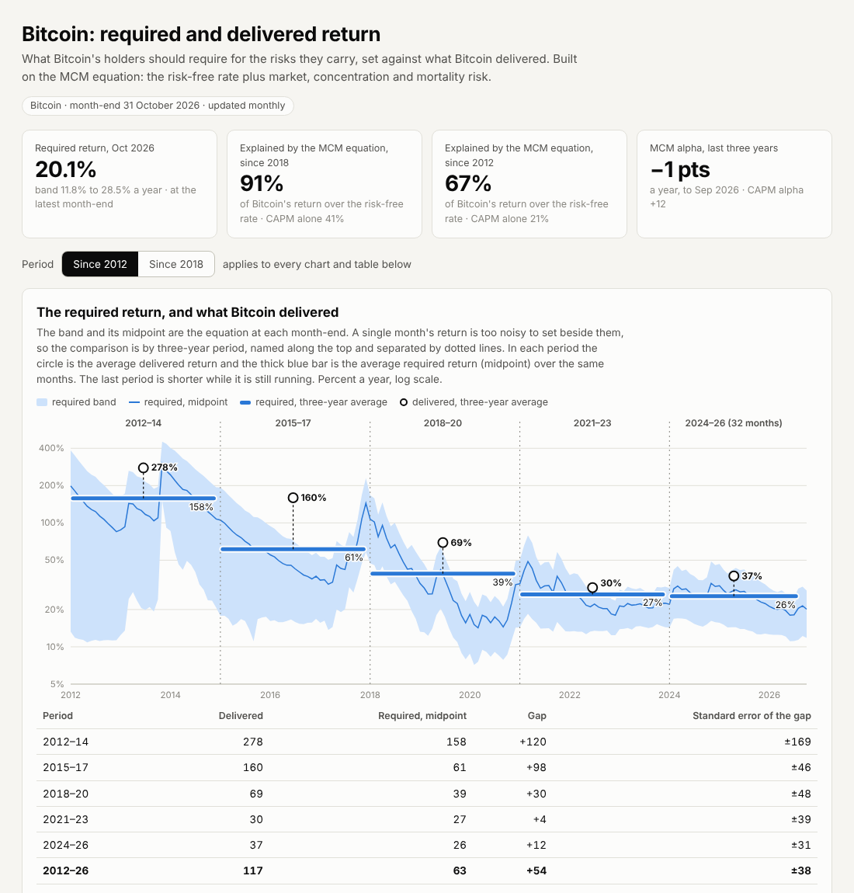

# Crypto observatory

[](https://github.com/apapadogiannis/crypto-observatory/actions/workflows/check.yml)
[](https://doi.org/10.5281/zenodo.24403325)

What return should a cryptoasset's holders require, and did they get it? Recomputed every month from
public data.

**Live page: https://apapadogiannis.github.io/crypto-observatory/**

By [Agisilaos Papadogiannis](https://github.com/apapadogiannis).



## Use it from your own AI assistant

One skill covers this tool and the rest of the research: a short file that tells an assistant when to
use the work, where the files are and how to read them. It holds no figures, so it does not go stale.
For Claude Code:

```bash
mkdir -p ~/.claude/skills/papadogiannis-finance-research
curl -o ~/.claude/skills/papadogiannis-finance-research/SKILL.md https://raw.githubusercontent.com/apapadogiannis/apapadogiannis/main/skill/SKILL.md
```

Then ask, for example, "what return should Bitcoin's holders require now?". Other assistants that
read `SKILL.md` files take the same file in their own skills folder. This tool no longer publishes a
skill of its own: a copy added earlier keeps working, since it only points to the files below.

## For AI agents and programs

Read [`api/llms.txt`](api/llms.txt) first. It says what this is, what it adds over computing it
yourself, which file to use for what, and what not to use it for. The same files are served from the
live page's address.

| File | Content |
|---|---|
| `api/latest.json` | start here: the latest required return of every asset with its terms and inputs, the comparison with stocks, the licence and the citation, in one small file with units in the field names |
| `api/assets.csv` | the same figures as a table, one row per asset |
| `api/assets_monthly.csv` | one row per asset and month-end, since each asset has been priced |
| `api/data.json` | everything behind the page in one large file |
| `api/months.csv` | one row per month-end: the required-return band, its terms and inputs |
| `api/periods.csv` | one row per period: delivered and required return, and what each model explains |
| `api/census_deaths.csv` | every cryptoasset that was ever in the top twenty by trading volume and died, with the rule that classified it |
| `api/vintages.csv` | the required return of each month-end as first published; rows are added, never rewritten |
| `api/datapackage.json` | the licence, the citation and the meaning of every column |
| `api/llms.txt` | the guide |

These files are rebuilt from `data/` by `build.py` and checked by the tests. Do not edit them by hand.

## What it is

A page and a data file that answer one question for a cryptoasset: what return should its holders
require for the risks they carry, and what did the asset deliver?

The required return is computed with the MCM equation of
[Bitcoin's Required Return](https://doi.org/10.2139/ssrn.7705239) (Papadogiannis 2026):

```
required return = risk-free rate + market risk + concentration risk + mortality risk
                = r_f + beta x ERP + gamma x sigma^2 x w + lambda x (1 - delta)
```

The site has five sections.

**Compare** is the landing page: the required return of Bitcoin, Ether, BNB, Solana and Tron side by
side, what each is made of (risk-free rate, market, concentration and mortality risk), the inputs
behind it, the Sharpe ratio of each and what a position held alone would compound at, and how each has moved. Gold and three
equity series (US market, developed markets, US small caps) are priced the same way for scale, and
Bitcoin is set beside them, with what a position held alone would compound at.

**Bitcoin** has the full history and the tests, in four tabs:

1. **Overview.** The required return and what was delivered, by three-year period, with one standard
   error around each delivered average, and how much of the delivered return the CAPM and the MCM
   equation each explain.
2. **Tests.** Why delivered differed from required, what each model leaves unexplained through time,
   and, folded away, the cumulative view and the rerun with the equity premium implied by stock prices.
3. **Volatility and drawdown.** What a position held alone would compound at if Bitcoin earned its
   required return; how much each holder is paid for volatility against the drag she bears, and whether
   the required return covers the drag of a position held alone; the latest band at other volatilities; and where Bitcoin stands (distance from its highest month-end close, volatility
   against its own past) with the record of the twelve months that followed similar month-ends. A
   record with the number of separate spells behind each row, not a forecast.
4. **Trend and path.** A straight trend line of the kind price dashboards draw, with its bands, beside
   the path the required return implies from the latest month-end, started at a price level the
   reader chooses (the latest close, a past peak, the level of the trend line): where each leads in
   three years. Neither is a forecast.

**Altcoins** takes Ether, BNB, Solana and Tron one at a time: the required return through time, the two terms and three inputs that differ from asset to asset, and Bitcoin's
monthly test run on each. The test is shown with its limits: the four are survivors, their records are
short, and neither model is rejected for any of them.

**Method** explains how every figure is computed, in four tabs: the MCM equation term by term, with
sliders; how the band is built, which holder sets each edge, and the three risks with their inputs;
where the holder's weight comes from (the surveyed owner at 19%, the surveys in the United Kingdom and
Canada, fund and treasury investors, the early holder); and the census of cryptoasset deaths behind
the mortality term.

**Data** lists the files, gives a prompt to paste into an AI assistant, and says what the site does
not claim, with the method, sources and dates.

Addresses the site used before its sections were regrouped still open the right place.

## Status

Five cryptoassets: Bitcoin in full, and Ether, BNB, Solana and Tron priced with the same equation. The
data are updated on the third of each month by a scheduled job, which downloads the new days, stores
them in `data/`, reruns the check and rebuilds the page. A live census of deaths is to follow.

## Quickstart

Python 3.11 or later.

```bash
pip install -r requirements.txt
python3 -I tests/test_continuity.py    # reproduces the paper's stored results
python3 -I tests/test_agent_files.py   # the files in api/ agree with data.json
python3 -I build.py                    # writes _site/index.html and _site/data.json
python3 update.py                      # optional: downloads the latest data into data/
```

Open `_site/index.html` in a browser. The page draws its charts with one library (d3 7.9.0, ISC License, copyright Mike Bostock),
served from the site itself, and counts visits with GoatCounter.

## Layout

```
observatory/mcm.py            the required-return band, month by month
observatory/tests_of_fit.py   the monthly test, CAPM and MCM alpha, shares explained
observatory/compare.py        Bitcoin beside equities: required returns, and what a position held alone compounds at
observatory/state.py          pay for variance, what a position held alone compounds at, the state with what followed, trend and path
observatory/build.py          builds the page and the data file from the stored data
observatory/publish.py        writes the files for programs and AI agents (api/)
api/                          those files: latest.json, assets.csv, assets_monthly.csv, months.csv, periods.csv, census_deaths.csv, vintages.csv, datapackage.json, llms.txt
observatory/assets.py         the same equation for Ether, BNB, Solana and Tron (kappa, the crypto market)
tools/census_from_paper.py     builds the census tables in data/census/ from the paper's result files (run once)
observatory/inputs.py         reads the stored files
observatory/update.py         downloads the latest data into data/ (the only code that uses the network)
config/model.toml             constants and hand-entered anchors, each with its source
data/                         all input data (see data/README.md)
site/template.html            the page
site/assets/                  the mark as the tab icon, the phone icon and the card shown when the page is shared
tests/test_continuity.py      checks the code against the paper on a frozen snapshot
tests/test_agent_files.py     checks the files in api/ against data.json
tests/snapshot/               the frozen inputs of the paper
reference/                    the paper's stored results that the test compares against
```

## The data file

`data.json` carries every number on the page under plain names, so that a script or an AI tool
can read it without scraping the page.

| Key | Holds |
|---|---|
| `meta` | asset, date of the data, units, method, sources, and under `credit` the licence, the citation and the paper |
| `latest` | the required return of the latest month, worked out term by term at both edges and the midpoint |
| `months` | one entry per month-end: the band, the terms at the midpoint, the inputs, supply measures, the next month's return with what each model leaves unexplained, what a position held alone would compound at, the pay for variance and the drawdown |
| `periods` | three-year periods and the two summary samples: delivered, required, the gap and its split, the part each model explains and leaves unexplained, the regression alphas, the average beta and correlation |
| `comparison` | Bitcoin and three equity series at the latest month-end: beta, required return, what a position held alone compounds at, volatility, drag, Sharpe ratios |
| `notes` | the figures quoted under "What this site does not claim", recomputed at each update |
| `strength` | the equation against a fixed premium: the unexplained return of each model and of one constant in 2012-17, since 2018 and over the whole record |
| `equity_premium` | the tests of fit recomputed with other equity risk premia: the paper's fixed 4%, and the premium implied by stock prices each month |
| `assets` | Bitcoin, Ether, BNB, Solana and Tron side by side: the latest month-end and every month each has been priced; under `tests`, Bitcoin's monthly test run on the other four, to be read with the limits the guide states |
| `holders` | what the holder's weight rests on: the owners' weight, the weight of fund and treasury investors, the ownership surveys behind the early holder's weight, and the British and Canadian survey waves shown under Holders |
| `census` | the census of deaths: death rates by age and by size with their intervals, survival by size, deaths by year, the list of top-twenty deaths with the rule behind each, the counts by rule, and what is left out |
| `volatility_sensitivity` | the latest band, and what a position held alone would compound at, recomputed at other volatilities with the other inputs held, and the pay for variance at each edge, to be read against the one half that a position held alone loses |
| `state` | where Bitcoin stood at the month-end (price, distance from its highest month-end close, volatility) and, for each of the two periods, what followed similar month-ends over the next twelve months, with the number of separate spells behind each row |
| `path` | a straight trend line through the log of the month-end closes, for each period, and the price path the required return implies from the latest month-end, started at the latest close, at past peaks and at the level of the trend line: where each leads in three years; with the month-end closes behind the chart |
| `vintages` | what was published for each month-end when it was first computed |
| `meta.model` | the model's fixed settings (equity premium, risk aversion, scales, windows, caps) and `meta.anchors_age_months`, the age of the hand-entered inputs |

Figures are percent a year unless the key says otherwise.

## How the check works

```bash
python3 -I tests/test_continuity.py
```

The model code in this repository is a clean rewrite of the paper's scripts. To show that it is the
same model, the test runs it on the paper's frozen inputs (`tests/snapshot/`) and compares the result
with the paper's stored outputs (`reference/`):

1. the monthly band: 173 months and nine columns, each within the four decimals the paper stores;
2. the monthly test: delivered, required, gap and its standard error for every period;
3. the unexplained return of the CAPM and of the MCM equation, added up and as a share explained;
4. the regression alphas, their standard errors and slopes.

A second test, `tests/test_agent_files.py`, checks that the files in `api/` are exactly what the build
produces and carry the same numbers, licence and citation as `data.json`.

The page is built only if both pass. The check shows that the code reproduces the paper. It does
not show that the data or the argument is right.

The live page uses sources that can be downloaded on a schedule, which differ slightly from the
paper's for the equity market and the Treasury yield. `data/README.md` states the differences.

## Configuration

`config/model.toml` holds every constant of the equation and every anchor that is entered by hand:
the surveyed owners' portfolio weight, survey ownership, and Bitcoin held through funds and by public companies. Each
carries its date and its place in the paper. Changing a value there changes the page; nothing is
hard-coded in the model.

## Privacy

The page is a static file. It sets no cookies and asks nothing of the visitor. It counts visits with GoatCounter, which sets no cookies and keeps no IP address: it records the page
opened, the site the visitor came from, the browser, the screen size and the country.
That is the only outside request the page makes.

## Data and licensing

- Copyright (c) 2026 Agisilaos Papadogiannis.
- Code: MIT License.
- The page's text, charts and numbers (`data.json`): CC BY 4.0. Cite the tool and the paper. This does
  not extend to the Bitcoin prices given in `data.json` (under `state` and `path`) and `latest.json`, nor
  to figures that restate prices closely: those keep the terms of the line below.
- Coin Metrics community data in `data/coinmetrics`: CC BY-NC 4.0
  (https://creativecommons.org/licenses/by-nc/4.0/), non-commercial use with attribution. It is not covered by the two licenses above.
- Equity market returns in `data/market`: copyright Kenneth R. French.
- Implied equity premium in `data/market`: Aswath Damodaran, NYU Stern, used with attribution.
- Other sources are listed in `data/README.md`.

## Citation

Cite the tool and the paper whose method it uses:

> Papadogiannis, A. (2026). "Crypto Observatory: required returns, risks and survival." Zenodo.
> https://doi.org/10.5281/zenodo.24403325

> Papadogiannis, A. (2026). "Bitcoin's Required Return: Market Risk, Concentration and Mortality."
> Working paper. https://doi.org/10.2139/ssrn.7705239

The Zenodo DOI above is the concept DOI: it always resolves to the latest archived version. Each
release also has its own DOI, listed on the Zenodo record.

## Disclaimer

Independent research; no funding, no institutional position. For informational and academic purposes
only. Not financial, investment, tax or legal advice, and not a recommendation to buy or sell any
financial instrument.
